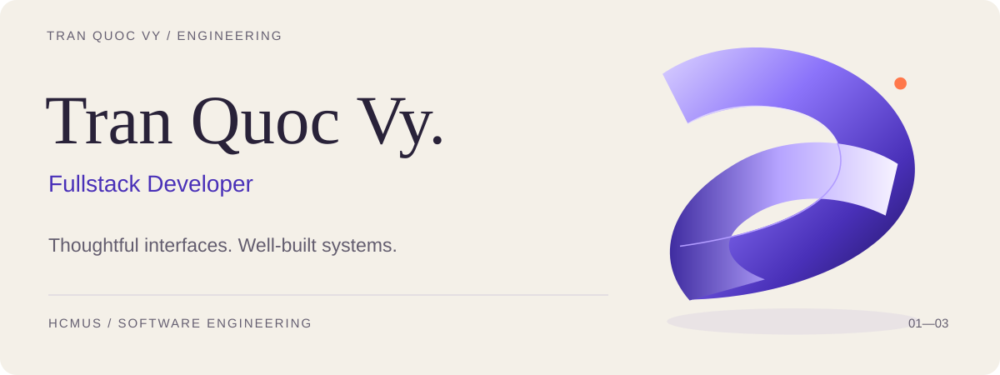
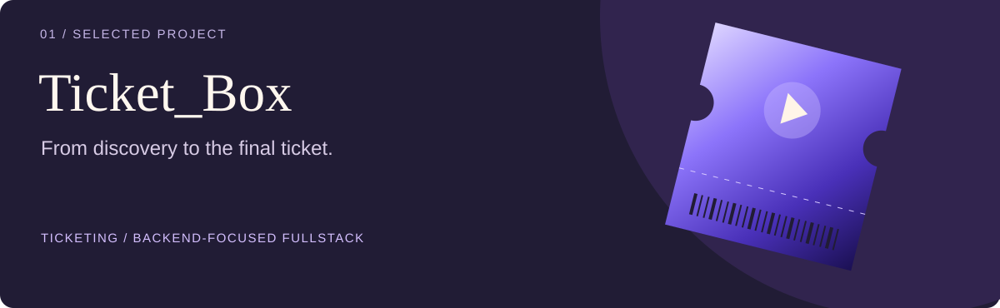
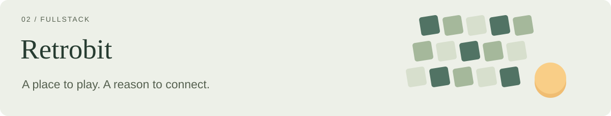
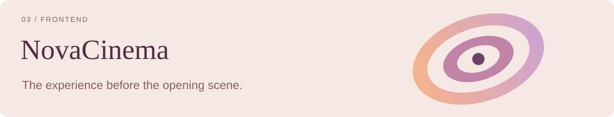

<picture>
  <source media="(max-width: 600px)" srcset="assets/hero-mobile.svg">
  
</picture>

  <a href="#user-content-about">About</a> ·
  <a href="#user-content-toolkit">Toolkit</a> ·
  <a href="#user-content-selected-work">Selected work</a> ·
  <a href="#user-content-lets-connect">Connect</a>

## About

I’m **Tran Quoc Vy**, a final-year Software Engineering student at **HCMUS** and a **Fullstack Developer** who leans toward the backend. I like the parts of a product that have to keep working when things go wrong: payments, background jobs, caching, and the pipelines that ship them.

Everything below is team coursework. Each project lists **what I personally built**, with links to the pull requests.

## Toolkit

A project-led toolkit, from interface to delivery.

<b>Interfaces</b> 

<b>Services</b> 

<b>Data</b> 

<b>Delivery</b> 

Also used in projects · C# / .NET (WinUI 3, xUnit) · MongoDB / Mongoose · Jenkins

## Selected work

<a href="https://github.com/CQ23-SoftwareDesign-2026/Ticket_Box/tree/develop">
<picture>
  <source media="(max-width: 600px)" srcset="assets/ticket-box-mobile.svg">
  
</picture>
</a>

### [Ticket_Box](https://github.com/CQ23-SoftwareDesign-2026/Ticket_Box/tree/develop)

**Flagship · Backend lead for payments and background processing** · team of 4

A concert-ticketing platform covering event discovery, reservations, checkout, and staff check-in.

**What I built**

- **Payments (PayOS):** gateway behind a Strategy interface; two-layer idempotency with a Redis `SET NX` reservation plus a unique key in PostgreSQL; an `opossum` circuit breaker per gateway (3 s timeout, opens at 50% errors); checkout-session reuse and reconciliation of timed-out transactions. — [#36](https://github.com/CQ23-SoftwareDesign-2026/Ticket_Box/pull/36), [#38](https://github.com/CQ23-SoftwareDesign-2026/Ticket_Box/pull/38), [#96](https://github.com/CQ23-SoftwareDesign-2026/Ticket_Box/pull/96)
- **Order ↔ payment integration:** cancellation and failed-webhook paths that release held inventory, plus a scheduled cleanup for expired pending orders. — [#52](https://github.com/CQ23-SoftwareDesign-2026/Ticket_Box/pull/52)
- **Background jobs on RabbitMQ:** streamed CSV guest-list import with batched PostgreSQL upserts and job-progress tracking; artist-bio generation from PDF press kits via Gemini; email and in-app notifications. — [#63](https://github.com/CQ23-SoftwareDesign-2026/Ticket_Box/pull/63), [#64](https://github.com/CQ23-SoftwareDesign-2026/Ticket_Box/pull/64)
- **Caching and storage:** Redis cache-aside for concert reads, a Redis token-bucket rate limiter, and a cron job that removes orphaned files from Supabase Storage. — [#33](https://github.com/CQ23-SoftwareDesign-2026/Ticket_Box/pull/33), [#62](https://github.com/CQ23-SoftwareDesign-2026/Ticket_Box/pull/62)
- **Delivery:** GitHub Actions CI (lint, typecheck, Prisma validation, migration check, build) and a multi-stage Docker image deployed to Railway. — [#18](https://github.com/CQ23-SoftwareDesign-2026/Ticket_Box/pull/18)

**Built with** · TypeScript, NestJS, PostgreSQL/Prisma, Redis, RabbitMQ, Docker, GitHub Actions.

[Explore the implementation ↗](https://github.com/CQ23-SoftwareDesign-2026/Ticket_Box/tree/develop)

---

<a href="https://github.com/web-dev-23-31/Retrobit_Board_Game">
<picture>
  <source media="(max-width: 600px)" srcset="assets/retrobit-mobile.svg">
  
</picture>
</a>

### [Retrobit Board Game](https://github.com/web-dev-23-31/Retrobit_Board_Game)

**Backend owner and game developer** · team of 4

A retro-inspired browser-game platform with saved sessions, rankings, and achievements.

**What I built**

- The Express/Knex API foundation: users, email OTP over SMTP, games, and save/resume game sessions. — [#2](https://github.com/web-dev-23-31/Retrobit_Board_Game/pull/2), [#3](https://github.com/web-dev-23-31/Retrobit_Board_Game/pull/3), [#6](https://github.com/web-dev-23-31/Retrobit_Board_Game/pull/6)
- An ELO rating system with a dynamic K-factor and fixed bot ratings for player-vs-AI modes, plus the achievements service. — [ELO module](https://github.com/web-dev-23-31/Retrobit_Board_Game/tree/main/backend/src/services/elo), [#12](https://github.com/web-dev-23-31/Retrobit_Board_Game/pull/12)
- Match-3 and Memory games, game-management screens, and the frontend and backend deployments. — [#36](https://github.com/web-dev-23-31/Retrobit_Board_Game/pull/36), [#50](https://github.com/web-dev-23-31/Retrobit_Board_Game/pull/50)

**Built with** · Express, PostgreSQL/Knex, JWT, React, Vite, Tailwind CSS.

---

<a href="https://github.com/hoquangsang/NovaCinema">
<picture>
  <source media="(max-width: 600px)" srcset="assets/novacinema-mobile.svg">
  
</picture>
</a>

### [NovaCinema](https://github.com/hoquangsang/NovaCinema)

**Fullstack contributor: auth, payments, admin, AI chat** · team of 4

A cinema discovery and booking platform with movies, theaters, showtimes, and an admin area.

**What I built**

- The NestJS authentication module and a follow-up architecture refactor, with written architecture notes. — [#3](https://github.com/hoquangsang/NovaCinema/pull/3), [#4](https://github.com/hoquangsang/NovaCinema/pull/4)
- A QR-based payment page with cancel and retry-after-expiry flows. — [#42](https://github.com/hoquangsang/NovaCinema/pull/42), [#51](https://github.com/hoquangsang/NovaCinema/pull/51)
- Admin screens for movies, rooms (with a seat-map editor), showtimes (including bulk scheduling), and user roles. — [#41](https://github.com/hoquangsang/NovaCinema/pull/41)
- A Gemini-powered chatbot: backend module plus a markdown chat UI. — [#47](https://github.com/hoquangsang/NovaCinema/pull/47)

**Built with** · NestJS, MongoDB/Mongoose, React, TypeScript, Vite, Tailwind CSS.

---

### [TechHaven — Window Shop](https://github.com/techhaven-app/window-shop-app)

**Desktop client and testing** · team of 5

A Windows desktop app for small shops to manage products, orders, customers, and sales reports.

**What I built**

- Most of the WinUI 3 presentation layer in MVVM: shell, dashboard, orders, settings, theming, and responsive layouts. — [#45](https://github.com/techhaven-app/window-shop-app/pull/45), [#69](https://github.com/techhaven-app/window-shop-app/pull/69), [#74](https://github.com/techhaven-app/window-shop-app/pull/74)
- HTTP service layer, login with mock MFA, remember-me, sign-up, and trial mode. — [#16](https://github.com/techhaven-app/window-shop-app/pull/16), [#33](https://github.com/techhaven-app/window-shop-app/pull/33), [#95](https://github.com/techhaven-app/window-shop-app/pull/95)
- Unit tests across auth, products, orders, customers, and reports, and the packaged release builds. — [#121](https://github.com/techhaven-app/window-shop-app/pull/121), [#138](https://github.com/techhaven-app/window-shop-app/pull/138)

**Built with** · C#, .NET, WinUI 3, MVVM, xUnit, Moq, FluentAssertions.

All projects are team coursework, not production systems. “What I built” lists my own work; links point to my pull requests. Original editorial covers.

## Let’s connect

For projects and collaboration, find me on [GitHub ↗](https://github.com/tranquocvy).

Thoughtful interfaces. Well-built systems.
