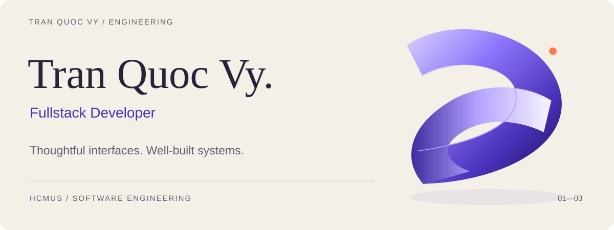
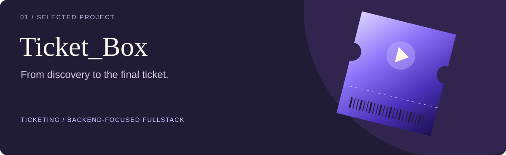
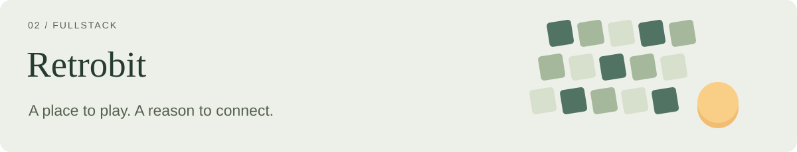
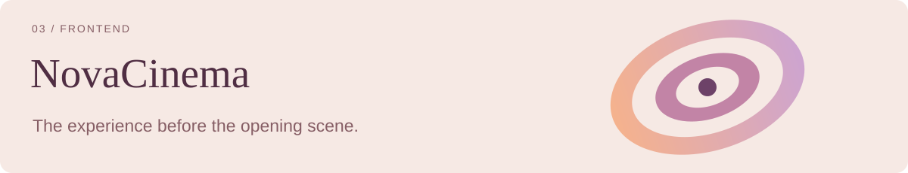

<picture>
  <source media="(max-width: 600px)" srcset="assets/hero-mobile.svg">
  
</picture>

  <a href="#about">About</a> ·
  <a href="#toolkit">Toolkit</a> ·
  <a href="#selected-work">Selected work</a> ·
  <a href="#lets-connect">Connect</a>

## About

I’m **Tran Quoc Vy**, a **Fullstack Developer** and Software Engineering student at **HCMUS**. I enjoy connecting thoughtful user experiences with the APIs, data models, and application logic behind them.

My project work spans backend-focused development, fullstack leadership, and frontend implementation — three perspectives on building a complete product.

## Toolkit

A project-led toolkit, from interface to delivery.

<b>Interfaces</b> 

<b>Services</b> 

<b>Data</b> 

<b>Delivery</b> 

## Selected work

<a href="https://github.com/CQ23-SoftwareDesign-2026/Ticket_Box/tree/develop">
<picture>
  <source media="(max-width: 600px)" srcset="assets/ticket-box-mobile.svg">
  
</picture>
</a>

### [Ticket_Box](https://github.com/CQ23-SoftwareDesign-2026/Ticket_Box/tree/develop)

**Flagship · Backend-focused, with frontend involvement**

A concert-ticketing platform connecting event discovery, reservations, checkout, and staff check-in. My involvement is primarily backend development, with additional frontend work.

**Engineering highlights**

- **Reservation logic:** Redis/Lua inventory updates and per-user limits, with compensation when queue publication fails.
- **Order lifecycle:** RabbitMQ-driven order creation and hold expiration, plus scheduled cleanup.
- **Payment workflows:** PayOS integration with idempotency tracking, checkout-session reuse, and timeout reconciliation.
- **Operational tools:** Gate-scoped check-in with conditional database updates; queued CSV imports and PDF-processing jobs.

**Built with** · TypeScript, NestJS, Next.js, PostgreSQL/Prisma, Redis, RabbitMQ, Docker.

[Explore the implementation ↗](https://github.com/CQ23-SoftwareDesign-2026/Ticket_Box/tree/develop)

---

<a href="https://github.com/web-dev-23-31/Retrobit_Board_Game">
<picture>
  <source media="(max-width: 600px)" srcset="assets/retrobit-mobile.svg">
  
</picture>
</a>

### [Retrobit Board Game](https://github.com/web-dev-23-31/Retrobit_Board_Game)

**Fullstack Lead**

A retro-inspired browser-game platform with saved sessions, rankings, achievements, and social features. My role spans frontend and backend development.

- Shared game-session hooks connect save/resume flows to Express APIs and PostgreSQL/Knex persistence.
- Game results feed rankings and achievements; friendship and messaging workflows round out the player experience.

**Built with** · React, JavaScript, Vite, Tailwind CSS, Express, PostgreSQL/Knex.

---

<a href="https://github.com/hoquangsang/NovaCinema">
<picture>
  <source media="(max-width: 600px)" srcset="assets/novacinema-mobile.svg">
  
</picture>
</a>

### [NovaCinema](https://github.com/hoquangsang/NovaCinema)

**Frontend Developer**

A frontend for cinema discovery and booking, spanning movie pages, showtimes, seat selection, checkout, and management views.

- Component-based booking UI connects seat availability, selection, and pricing to checkout.
- TanStack Query, auth Context, and an Axios client support API-integrated screens and payment-status presentation.

**Frontend stack** · React, TypeScript, Vite, Tailwind CSS, TanStack Query, Axios.

Team projects · Roles reflect my involvement; highlights describe the projects. Original editorial covers.

## Let’s connect

For projects and collaboration, find me on [GitHub ↗](https://github.com/tranquocvy).

Thoughtful interfaces. Well-built systems.
