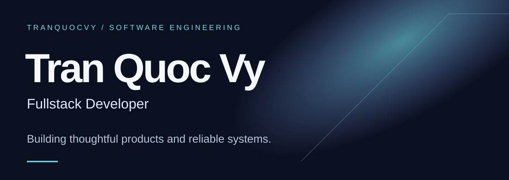
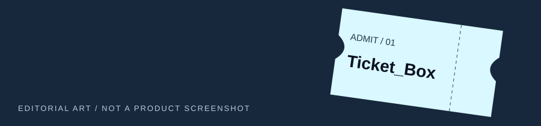
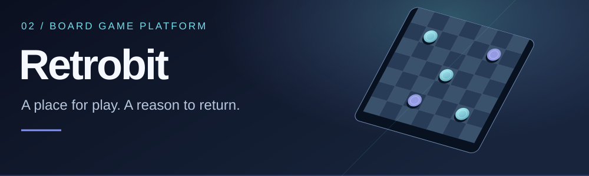
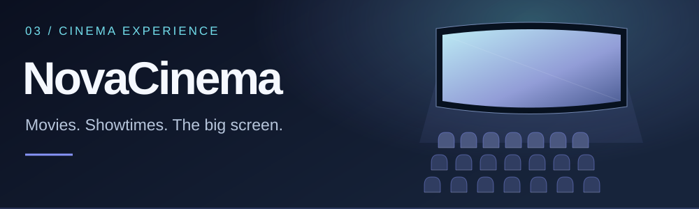

<picture>
  <source media="(max-width: 600px)" srcset="assets/profile/hero-mobile.svg">
  
</picture>

## About

I'm **Tran Quoc Vy**, a final-year student at **VNUHCM – University of Science (HCMUS)** and a **Fullstack Developer** interested in product development and software engineering. I enjoy connecting the product experience with the systems behind it. My current strengths are backend development, databases and DevOps, while I continue growing across the frontend.

## Across the stack

   &nbsp;
   &nbsp;
   &nbsp;
   &nbsp;
   &nbsp;
  

**Backend & Data** — **Core** · Node.js · NestJS · PostgreSQL · Redis · Prisma

**DevOps & Delivery** — **Core** · Docker · GitHub Actions · Jenkins · Linux · Git

Additional experience · Frontend, Backend &amp; Data, DevOps

**Frontend** · HTML · CSS · JavaScript · TypeScript · React · Next.js · Tailwind CSS

**Backend & Data** · C# / .NET · Java / Spring Boot · Python · MySQL · SQL Server

**DevOps & Delivery** · Kubernetes

## Selected work

Original editorial illustrations — not product screenshots.

### 01 / Ticket_Box

**Featured project · Event ticketing**

A collaborative event-ticketing project connecting booking with backend order and payment workflows.

- RabbitMQ consumer for asynchronous order creation.
- Payment idempotency-key validation and cached-response handling.
- Backend, web and mobile source organized in one workspace.

**Selected stack:** NestJS · Prisma · Redis · RabbitMQ  
[Explore source on develop →](https://github.com/CQ23-SoftwareDesign-2026/Ticket_Box/tree/develop)

### 02 / Retrobit Board Game

A collaborative browser-based gaming platform with accounts, game sessions, achievements and rankings.

- Express APIs backed by PostgreSQL and Knex migrations.
- React frontend with Vite and Tailwind CSS.

[View repository →](https://github.com/web-dev-23-31/Retrobit_Board_Game)

### 03 / NovaCinema

A collaborative cinema booking and management project organized around movies, theaters and showtimes.

- Modular NestJS backend with MongoDB / Mongoose.
- React frontend with Vite and Tailwind CSS.

[View repository →](https://github.com/hoquangsang/NovaCinema)

---

[Find me on GitHub · @tranquocvy](https://github.com/tranquocvy)
